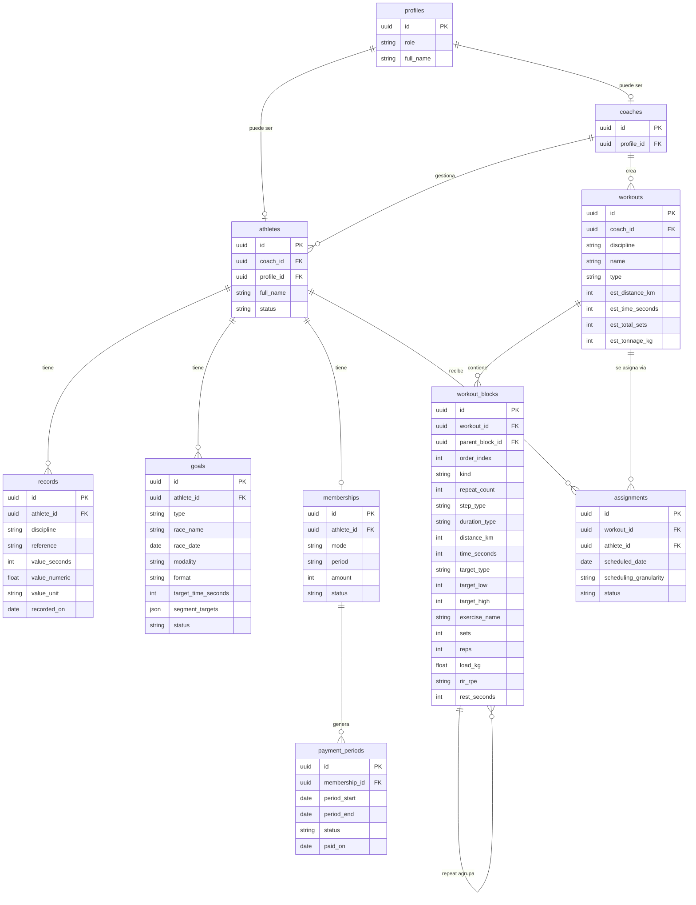

# PRD: Umbral Training

**Estado**: Borrador
**Autor**: Alex (Product Manager)
**Última actualización**: 2026-08-11
**Versión**: 1.1
**Stakeholders**: Entrenadora (product owner / usuaria principal), Desarrolladora única (eng + design)

> Herramienta interna de gestión de entrenamiento para una entrenadora de running, triatlón y gimnasio (fuerza) y sus atletas. Proyecto personal, pocos usuarios, una sola desarrolladora. Prioridad: **decisiones simples y reversibles** por encima de lo "óptimo".

> **Changelog v1.1** — Decisiones confirmadas por el usuario e incorporadas: (1) app multidisciplina **running + triatlón + gimnasio**; (2) alta de atletas **por invitación por email**; (3) pagos **mensuales con monto por atleta**; (4) constructor con **repeticiones anidadas**. Añadida la disciplina **gimnasio/fuerza** (estructura por ejercicios, no por intervalos).

---

## 1. Visión y problema que resuelve

### El problema
Una entrenadora de running/triatlón gestiona a un grupo reducido de atletas usando hoy una mezcla de hojas de cálculo, notas, mensajes de WhatsApp y documentos sueltos. Esto genera tres dolores concretos:

1. **Dispersión de la información del atleta.** Marcas por distancia, objetivos de carrera, historial de progreso y estado de pago viven en sitios distintos. No hay una foto única del atleta ni de su evolución en el tiempo.
2. **Construcción de entrenos lenta y poco reutilizable.** Diseñar una sesión con series, repeticiones, descansos y rangos de ritmo es artesanal y propenso a errores de cálculo (¿cuánto suma en distancia y tiempo este entreno?).
3. **Entrega del entreno poco clara para el atleta.** Lo que la entrenadora tiene claro en su cabeza llega al atleta como texto ambiguo. Falta un artefacto limpio y comprensible.

### La visión
**Umbral Training** es el panel de control donde la entrenadora convierte su conocimiento en planes ejecutables y medibles. "Umbral" alude al *umbral de rendimiento* (threshold): el punto donde el esfuerzo se vuelve mejora. El producto existe para que cada sesión empuje al atleta hacia su umbral con intención, no por inercia.

En una frase: **Umbral Training centraliza al atleta, acelera la creación de entrenos estructurados y los entrega en un formato que el atleta entiende de un vistazo.**

### Por qué ahora
Es un proyecto personal con un alcance acotado y usuarios conocidos, lo que permite validar valor sin fricción comercial. El costo de no hacerlo es seguir perdiendo tiempo en tareas administrativas que restan horas al trabajo de entrenamiento real.

---

## 2. Personas y Jobs-to-be-Done

### Persona primaria: La Entrenadora ("Coach")
Gestiona entre 5 y 30 atletas. Usa la herramienta a diario o semanalmente. Es la única que crea y edita contenido de entrenamiento.

**Jobs-to-be-done:**
- *"Cuando doy de alta a un atleta nuevo, quiero registrar sus marcas base y su objetivo, para poder diseñarle un plan acorde."*
- *"Cuando planifico la semana, quiero construir sesiones con series y rangos de ritmo rápido, para no calcular tiempos y distancias a mano."*
- *"Cuando termino un entreno, quiero entregárselo al atleta en un PDF claro, para que lo ejecute sin dudas."*
- *"Cuando reviso el mes, quiero saber quién ha pagado y quién no, para gestionar el cobro sin perseguir a nadie."*
- *"Cuando un atleta mejora una marca, quiero registrarlo, para ver su evolución y ajustar los rangos de intensidad."*

### Persona secundaria: El Atleta
Consume su propio plan. Rol de solo-lectura sobre su información. Pocos accesos por semana.

**Jobs-to-be-done:**
- *"Cuando recibo mi plan, quiero ver mis entrenos de la semana, para saber qué toca hoy."*
- *"Cuando entreno, quiero un formato simple con ritmos y distancias, para ejecutar sin interpretar."*
- *"Cuando quiero saber cómo voy, quiero ver mis marcas y mi objetivo, para mantenerme motivado."*

---

## 3. Roles y permisos (mapa e implicaciones RLS)

Dos roles: `coach` y `athlete`. La autorización principal se implementa con **Row-Level Security (RLS) de Supabase**; la app nunca es la única línea de defensa.

| Acción | Coach | Athlete |
|--------|-------|---------|
| Ver lista de atletas | ✅ (solo los suyos) | ❌ |
| Crear / editar / archivar perfil de atleta | ✅ | ❌ |
| Registrar / editar marcas y records | ✅ | ❌ (solo lectura de las suyas) |
| Definir / cambiar objetivo del atleta | ✅ | ❌ (solo lectura) |
| Crear / editar sesiones y entrenos | ✅ | ❌ |
| Asignar entrenos a un atleta / semana | ✅ | ❌ |
| Ver sus propios entrenos asignados | ✅ (todos) | ✅ (solo los suyos) |
| Descargar PDF de un entreno | ✅ | ✅ (solo los suyos) |
| Gestionar pagos / membresías | ✅ | ❌ (a futuro: ver su estado) |
| Ver su propio estado de pago | ✅ | ✅ (fase 2, opcional) |

### Implicaciones para RLS
- Cada tabla con datos de atleta lleva una columna de pertenencia (`athlete_id` y/o `coach_id`).
- **Política athlete:** `athlete_id = auth.uid()` (mapeado vía tabla de perfil) → solo ve sus filas.
- **Política coach:** el coach ve las filas de los atletas donde `coach_id = auth.uid()`. En MVP hay una sola coach, pero el modelo se diseña multi-coach desde el día uno para no reescribir políticas después (reversibilidad barata).
- La relación usuario→rol vive en una tabla `profiles` ligada a `auth.users`. El rol se lee en las políticas mediante una función `auth`-segura (p. ej. claim en JWT o subconsulta a `profiles`).
- **Regla de oro:** ninguna Server Action confía solo en el rol de la sesión de app; toda lectura/escritura pasa por conexiones que respetan RLS. Los módulos repositorio son el único punto de acceso a DB.

---

## 4. Alcance MVP: dentro / fuera

El MVP cubre **en paralelo** gestión y construcción de entrenos, tal como se decidió. Pero dentro de cada bloque se recorta a lo esencial.

### ✅ Dentro del MVP
- Autenticación con Supabase Auth. **Alta de atletas por invitación por email**: la coach invita, el atleta define su propia contraseña. Dos roles con RLS.
- CRUD de atletas (perfil gestionado por la coach).
- **Soporte multidisciplina: natación, ciclismo, carrera (triatlón) y gimnasio/fuerza.** Un plan puede combinar disciplinas. Las tres primeras son de **resistencia** (se estructuran por intervalos); gimnasio es de **fuerza** (se estructura por ejercicios → series × repeticiones × carga).
- Marcas base de **carrera** por distancia (1k, 5k, 10k, 21k), **todas opcionales**, con **histórico**. Modelo de marcas **tipado por disciplina** y extensible a natación (ritmo /100m), ciclismo (velocidad/potencia) y gimnasio (referencias de fuerza, p. ej. 1RM) sin sobre-ingeniería.
- Objetivo por atleta: **preparar carrera** (de running: 5k/10k/21k/42k; o de triatlón: sprint/olímpico/70.3/140.6) o **mantenimiento**.
- Pagos: **gestión manual** de estado por periodo mensual, **monto por atleta**, + soporte de atleta **gratuito**. Interfaz de pago preparada para pasarela futura (placeholder, sin integrar).
- Constructor de sesiones con **dos variantes**: (a) **resistencia** (nado/bici/carrera), estilo Garmin — pasos, **repeticiones anidadas** (repeats dentro de repeats), descansos, distancia o tiempo por paso, y **objetivo de intensidad según disciplina** (ritmo /km en carrera, /100m en natación, velocidad o potencia en ciclismo); (b) **gimnasio/fuerza** — ejercicios con **series × repeticiones × carga (kg)**, RIR/RPE y descansos, agrupables en superseries/circuitos (también repetibles). **Estimación automática de totales** (tiempo/distancia en resistencia; volumen/series/tonelaje en gimnasio).
- Registro de entrenos por atleta con periodicidad **semanal o mensual**.
- **Generación y descarga de PDF** del entreno, bonito y simplificado.
- UI 100% en **español**, unidades **métricas** (km, ritmo min/km, /100m).

### ❌ Fuera del MVP (explícito)
| Fuera de alcance | Por qué | Cuándo se revisa |
|------------------|---------|------------------|
| Integración real de pasarela de pago | Proveedor aún no definido; solo dejamos la interfaz | Fase 3, cuando se elija proveedor |
| Envío de PDF por email / compartir por otros medios | MVP entrega descarga; el envío añade infra de correo | Fase 2 |
| App móvil nativa | Web responsive cubre el caso; base de usuarios pequeña | No planificado |
| Auto-registro abierto de atletas (self sign-up público) | El alta es por invitación de la coach; menos superficie de seguridad | A evaluar si crece la base |
| Sincronización con Garmin/Strava (importar actividades reales) | Complejidad alta de OAuth + APIs; no es el dolor central | Later |
| Zonas de FC / VO2 / FTP calculadas y análisis fisiológico avanzado | El MVP modela objetivos de intensidad simples (ritmo, /100m, velocidad/potencia como valor), no zonas derivadas | Later |
| Transiciones (T1/T2) y modelado de la prueba de tri como carrera continua | El MVP planifica entrenos por disciplina, no simula la competición | Later |
| Facturación / recibos fiscales | Basta el estado de pago manual | A evaluar |
| Multi-idioma / unidades imperiales | Público hispanohablante, sistema métrico | No planificado |
| Notificaciones push / recordatorios | No es el dolor central del MVP | Later |
| Biblioteca compartida de plantillas entre coaches | Una sola coach hoy | Later |

---

## 5. Épicas y user stories

Notación de criterios de aceptación en estilo Gherkin (Dado/Cuando/Entonces) y checklists.

### Épica A — Gestión de atletas

**A1.** Como coach, quiero crear el perfil de un atleta, para empezar a gestionarlo.
- [ ] Dado que soy coach, cuando creo un atleta con nombre y email, entonces se crea su perfil asociado a mí (`coach_id`).
- [ ] Dado un email ya existente, cuando intento crearlo, entonces recibo un error claro y no se duplica.
- [ ] Campos mínimos: nombre. Opcionales: email, fecha de nacimiento, sexo, notas, foto.
- [ ] El atleta queda en estado `active` por defecto. Su cuenta de acceso queda `invited` hasta que acepte (ver A5).

**A5.** Como coach, quiero invitar al atleta por email para que cree su propia cuenta, sin gestionar contraseñas.
- [ ] Dado un atleta con email, cuando envío la invitación, entonces recibe un correo con un enlace de alta (usando el flujo de invitación de Supabase Auth).
- [ ] Dado el enlace de invitación, cuando el atleta lo abre, entonces **define su propia contraseña** y su `profile` (rol `athlete`) queda vinculado al registro `athletes` existente (`profile_id`).
- [ ] Estados de la cuenta del atleta: `invited` (invitado, sin aceptar) → `active` (aceptó y definió contraseña).
- [ ] Dado un enlace de invitación caducado o ya usado, cuando el atleta lo abre, entonces ve un mensaje claro y la coach puede **reenviar** la invitación.
- [ ] La coach puede gestionar la ficha del atleta aunque este aún no haya aceptado la invitación (los datos no dependen de la cuenta).

**A2.** Como coach, quiero archivar un atleta, para dejar de gestionarlo sin borrar su historial.
- [ ] Dado un atleta activo, cuando lo archivo, entonces pasa a `archived` y deja de aparecer en la lista principal.
- [ ] Sus datos históricos (marcas, entrenos, pagos) se conservan.
- [ ] Un atleta archivado puede reactivarse.

**A3.** Como coach, quiero ver la ficha de un atleta, para tener su foto completa.
- [ ] La ficha muestra: datos de perfil, objetivo actual, últimas marcas por distancia, estado de pago del periodo actual y entrenos recientes.

**A4.** Como atleta, quiero ver mi propia ficha, para consultar mi información.
- [ ] Dado que soy atleta, cuando entro, entonces solo veo mis datos (garantizado por RLS).

### Épica B — Marcas y records (métricas, multidisciplina)

Las marcas se modelan **tipadas por disciplina** (`run` | `swim` | `bike`). En MVP se implementa por completo la disciplina **carrera**; el modelo deja natación y ciclismo listos para activarse sin migración estructural (enfoque simple y reversible, ver sección 6).

**B1.** Como coach, quiero registrar una marca de carrera de un atleta en una distancia, para conocer su nivel.
- [ ] Disciplina `run`, distancias soportadas: 1k, 5k, 10k, 21k. Todas opcionales e independientes.
- [ ] Una marca tiene: disciplina, referencia (distancia), tiempo (hh:mm:ss), fecha de registro y nota opcional (p. ej. "test en pista" / "carrera oficial").
- [ ] El sistema calcula y muestra el **ritmo medio** (min/km) derivado del tiempo y la distancia.
- [ ] Puedo registrar **varias marcas** para la misma distancia en fechas distintas (histórico).

**B2.** Como coach, quiero ver la evolución de una marca en el tiempo, para valorar el progreso.
- [ ] Dado un atleta con ≥2 marcas en una misma referencia, cuando abro su evolución, entonces veo una gráfica temporal (tiempo o ritmo vs. fecha).
- [ ] La "marca actual" mostrada en la ficha es la más reciente por referencia.

**B3.** Como coach, quiero editar o borrar una marca mal introducida, para mantener datos limpios.
- [ ] Editar/borrar una marca no afecta a otras marcas de la misma referencia.

**B4.** Como atleta, quiero ver mis marcas y su evolución, para seguir mi progreso.
- [ ] Solo lectura de mis propias marcas.

**B5.** (Modelo listo, activación fase siguiente) Como coach, quiero poder registrar marcas de natación y ciclismo, para atletas de triatlón.
- [ ] El esquema de `records` admite `discipline` = `swim` (referencia de distancia en m, p. ej. 100m/400m/1500m; métrica derivada ritmo /100m) y `bike` (referencia de distancia en km; métrica velocidad km/h y opcional potencia W).
- [ ] En MVP la UI de alta se centra en `run`; natación/ciclismo pueden quedar tras una pestaña o activarse en fase siguiente sin cambiar el esquema (ver decisión Q10).

### Épica C — Objetivos

**C1.** Como coach, quiero asignar un objetivo a un atleta, para orientar su plan.
- [ ] Un atleta tiene **un objetivo activo** a la vez, de tipo `race` o `maintenance`.
- [ ] Si es `race`: nombre de carrera, fecha objetivo, **modalidad** y **formato**, y opcional tiempo objetivo.
  - Modalidad `running` → formato en {5k, 10k, 21k, 42k, otro}.
  - Modalidad `triathlon` → formato en {sprint, olímpico, 70.3, 140.6, otro}. Cada formato de triatlón implica tres segmentos (natación/ciclismo/carrera); el objetivo puede guardar **tiempo objetivo por segmento** opcional además del total.
- [ ] Si es `maintenance`: sin fecha ni formato obligatorios; nota opcional.
- [ ] El objetivo de tri no requiere modelar transiciones (T1/T2) en MVP — solo los tres segmentos.

**C2.** Como coach, quiero cambiar el objetivo cuando cambia el plan del atleta, sin perder el anterior.
- [ ] Al asignar un objetivo nuevo, el anterior se archiva (histórico de objetivos), no se borra.
- [ ] Dado un objetivo `race` con fecha pasada, el sistema lo marca como `completed`/`past` visualmente.

**C3.** Como coach, quiero ver una cuenta regresiva a la carrera, para dosificar el plan.
- [ ] Dado un objetivo `race` futuro, la ficha muestra "faltan N semanas/días".

### Épica D — Pagos y membresías

Modelo que soporta **tres casos**: pago manual, pago por pasarela futura y gratuito.

**D1.** Como coach, quiero asignar un plan/membresía a un atleta, para definir cómo paga.
- [ ] Modos de plan: `manual`, `free`, `gateway` (placeholder).
- [ ] Un plan define periodicidad (`monthly` por defecto) y monto (opcional; 0 o nulo si `free`).

**D2.** Como coach, quiero marcar el estado de pago de un periodo manualmente, para llevar el control.
- [ ] Cada periodo tiene estado: `pending`, `paid`, `overdue`, `waived` (exento/gratis).
- [ ] Dado un plan `manual`, cuando marco un periodo como `paid`, entonces registro fecha de pago y método/nota opcional.
- [ ] Dado un plan `free`, los periodos se crean directamente como `waived`.
- [ ] Vista de la coach: lista de atletas con su estado de pago del periodo actual (quién pagó / quién no).

**D3.** Como coach, quiero un placeholder de pasarela, para preparar la integración futura sin construirla ahora.
- [ ] Dado un plan `gateway`, la UI muestra un estado "Pasarela pendiente de integración" y **no** ejecuta ningún cobro.
- [ ] La interfaz `PaymentGateway` está definida en `domain`/`services` con una implementación *dummy* (no-op) que devuelve estado simulado. Cambiar a un proveedor real no debe requerir tocar los casos de uso.

**D4.** Como coach, quiero ver el histórico de pagos de un atleta, para resolver dudas.
- [ ] Lista de periodos con estado, fecha y monto.

### Épica E — Constructor de entrenos

El constructor tiene **dos variantes según la disciplina de la sesión**: **resistencia** (nado/bici/carrera, estilo Garmin, E1–E6) y **gimnasio/fuerza** (E7). La disciplina se elige al crear el `workout`.

**E1.** Como coach, quiero crear una sesión de resistencia con pasos, para estructurar el entreno.
- [ ] Una sesión (`workout`) tiene nombre, **disciplina** (`swim`|`bike`|`run`), tipo (p. ej. rodaje / series / test), notas y una lista ordenada de bloques.
- [ ] Un **paso** (`step`) tiene: tipo (`warmup`, `work`, `recovery`/`rest`, `cooldown`), objetivo de duración (**distancia** o **tiempo en mm:ss**) y objetivo de intensidad opcional **según disciplina**: rango de ritmo min/km (carrera), rango de ritmo /100m (natación), o velocidad km/h / potencia W (ciclismo); o "libre".
- [ ] Puedo reordenar y borrar pasos.

**E2.** Como coach, quiero agrupar pasos en una repetición ("Repeat N times"), incluso anidadas, para modelar series y pirámides.
- [ ] Un **repeat** contiene una lista ordenada de hijos (pasos **y/o** otros repeats) y un contador `N`.
- [ ] Ejemplo simple: `Repeat 8×[ Run 400m @ 4:00–4:10 ; Rest 90s libre ]`.
- [ ] **Anidación soportada** (repeats dentro de repeats), p. ej. pirámide `Repeat 2×[ Repeat 4×[ Run 200m ; Rest 60s ] ; Rest 3:00 ]`. Sin límite artificial de profundidad, pero la UI muestra la jerarquía con indentación clara.

**E3.** Como coach, quiero que el sistema estime totales, para no calcular a mano.
- [ ] Dado un entreno, el sistema calcula **distancia total estimada** y **tiempo total estimado**.
- [ ] Pasos por distancia con rango de ritmo → tiempo estimado usando el ritmo (se usa el punto medio del rango o extremos; ver Q5). Pasos por tiempo → distancia estimada de forma análoga.
- [ ] Los totales se recalculan al editar cualquier paso o repeticiones.
- [ ] Pasos "libres" (sin ritmo) por tiempo aportan al tiempo total pero **no** a la distancia (y viceversa); se marcan como estimación parcial.

**E4.** Como coach, quiero reutilizar un entreno como plantilla, para no empezar de cero.
- [ ] Puedo duplicar un entreno existente para editarlo.
- [ ] (MVP mínimo: duplicar. Biblioteca de plantillas formal → Later.)

**E5.** Como coach, quiero asignar un entreno a un atleta en una fecha/semana, para planificar.
- [ ] Un entreno asignado (`assignment`) vincula `workout` + `athlete` + fecha (o semana) + estado (`planned`, `done`, `skipped`).
- [ ] Puedo planificar por **semana** o por **mes** (vista de calendario/lista por periodo).
- [ ] Un mismo `workout` puede asignarse a varios atletas y varias fechas sin duplicar la definición.

**E6.** Como atleta, quiero ver mis entrenos asignados, para saber qué entrenar.
- [ ] Solo lectura de mis asignaciones; vista por semana actual por defecto.

**E7.** Como coach, quiero crear una sesión de **gimnasio/fuerza** por ejercicios, para planificar el trabajo de fuerza.
- [ ] Una sesión de gimnasio (`workout` con disciplina `gym`) se estructura por **ejercicios**, no por intervalos de distancia/ritmo.
- [ ] Un **ejercicio** tiene: nombre (p. ej. Sentadilla, Peso muerto), **series × repeticiones**, **carga** en kg (o "peso corporal"), **RIR/RPE** opcional, descanso entre series y nota opcional (tempo, técnica).
- [ ] Los ejercicios pueden agruparse en **superserie/circuito**, que admite un contador de **rondas** (equivalente al repeat de resistencia; también anidable).
- [ ] El sistema estima **tiempo total** y muestra **volumen** (nº de series totales y **tonelaje** = Σ series×reps×carga cuando hay carga numérica).
- [ ] Reordenar, duplicar y borrar ejercicios/grupos. Reutilizable como plantilla (duplicar, como E4).

### Épica F — Generación de PDF

**F1.** Como coach, quiero descargar el PDF de un entreno, para entregárselo al atleta.
- [ ] Dado un entreno, cuando pulso "Descargar PDF", entonces obtengo un PDF con: nombre del entreno, **disciplina**, atleta (opcional), fecha, contenido legible según variante y totales estimados.
  - Resistencia: lista de pasos/series con distancia/tiempo y objetivo de intensidad (incluida la anidación).
  - Gimnasio: lista de ejercicios con series × reps × carga y descansos (incluidos superseries/circuitos).
- [ ] El diseño es **simplificado y bonito**: jerarquía visual clara, series agrupadas ("8× 400m @ 4:00–4:10" / "4× Sentadilla 5×5 @ 80 kg"), en español y unidades métricas.
- [ ] El PDF se genera bajo demanda; no requiere almacenamiento persistente en MVP.

**F2.** Como atleta, quiero descargar el PDF de mi entreno asignado, para tenerlo offline.
- [ ] Solo mis propios entrenos.

**F3.** (Fase 2) Como coach, quiero enviar el PDF por email/compartir, para no depender de la descarga manual.
- [ ] Fuera del MVP. La generación de PDF se diseña como una **capacidad** (`services`) desacoplada del canal de entrega, de modo que "descargar" y "enviar por email" reutilicen el mismo render.

---

## 6. Modelo de datos propuesto

Alineado con la arquitectura: entidades y reglas puras en `src/lib/domain`, casos de uso en `src/lib/services`, y persistencia (Drizzle/Supabase) accesible **solo** vía módulos repositorio. `domain` y `services` no importan Next/Drizzle/Supabase.

### Entidades y atributos clave

- **profiles** — extiende `auth.users`. `id (FK auth.users)`, `role` (`coach`|`athlete`), `full_name`, `created_at`. Es el puente rol↔RLS.
- **coaches** — opcional/derivable de `profiles` con rol coach. `id`, `profile_id`. (En MVP hay una; se modela para multi-coach.)
- **athletes** — `id`, `coach_id`, `profile_id (nullable)`, `full_name`, `email`, `birth_date`, `sex`, `status` (`active`|`archived`), `notes`, `created_at`. `profile_id` es nulo hasta que el atleta tiene cuenta.
- **records** (marcas) — `id`, `athlete_id`, `discipline` (`run`|`swim`|`bike`|`gym`), `reference` (según disciplina: run `1k`/`5k`/`10k`/`21k`; swim `100m`/`400m`/`1500m`; bike distancia km; gym nombre de ejercicio para 1RM), `value_seconds (nullable)` (tiempo, para run/swim), `value_numeric (nullable)` + `value_unit (nullable)` (para bike `km/h`/`W`, gym `kg`), `recorded_on` (fecha), `source_note`, `created_at`. Ritmo/velocidad se **derivan** cuando aplica. Histórico = muchas filas por atleta+disciplina+referencia. En MVP la UI de alta se centra en `run`; el esquema ya admite el resto (ver B5).
- **goals** (objetivos) — `id`, `athlete_id`, `type` (`race`|`maintenance`), `race_name (nullable)`, `race_date (nullable)`, `modality (nullable)` (`running`|`triathlon`), `format (nullable)` (running: `5k`/`10k`/`21k`/`42k`/`otro`; triathlon: `sprint`/`olimpico`/`70.3`/`140.6`/`otro`), `target_time_seconds (nullable)` (total), `segment_targets (nullable, jsonb)` (tiempos objetivo por segmento nado/bici/carrera en tri), `status` (`active`|`archived`|`completed`), `notes`, `created_at`. Un solo `active` por atleta (regla de dominio).
- **memberships** (plan/membresía) — `id`, `athlete_id`, `mode` (`manual`|`free`|`gateway`), `period` (`monthly`), `amount (nullable)`, `currency`, `started_on`, `status` (`active`|`ended`).
- **payment_periods** (pagos por periodo) — `id`, `membership_id`, `period_start`, `period_end`, `status` (`pending`|`paid`|`overdue`|`waived`), `paid_on (nullable)`, `method_note (nullable)`, `amount (nullable)`. Para `free` se generan como `waived`; para `gateway` quedan `pending` a la espera de integración.
- **workouts** (sesión, definición reutilizable) — `id`, `coach_id`, `discipline` (`swim`|`bike`|`run`|`gym`), `name`, `type`, `notes`, `est_distance_km (nullable)` (cache derivado, resistencia), `est_time_seconds (nullable)` (cache derivado), `est_total_sets (nullable)` / `est_tonnage_kg (nullable)` (cache derivado, gimnasio), `created_at`. Los totales se recalculan en `services`; el cache es solo conveniencia.
- **workout_blocks** — modela el árbol de bloques de forma uniforme para **todas** las disciplinas. `id`, `workout_id`, `parent_block_id (nullable)`, `order_index`, `kind` (`step`|`repeat`|`exercise`), `repeat_count (nullable, si repeat)`. Un `repeat` agrupa hijos (pasos, ejercicios u otros repeats → soporta **anidación**); `step`/`exercise` son hojas.
  - Para `step` (resistencia): `step_type` (`warmup`|`work`|`recovery`|`cooldown`), `duration_type` (`distance`|`time`), `distance_km (nullable)`, `time_seconds (nullable)`, `target_type (nullable)` (`pace_km`|`pace_100m`|`speed_kmh`|`power_w`|`free`), `target_low (nullable)`, `target_high (nullable)`, `intensity_note`.
  - Para `exercise` (gimnasio): `exercise_name`, `sets (nullable)`, `reps (nullable)`, `load_kg (nullable)` (nulo = peso corporal), `rir_rpe (nullable)`, `rest_seconds (nullable)`, `tempo_note`.
  - *Alternativa de modelado*: tablas separadas por tipo. Se elige **tabla única con árbol autorreferenciado** por simplicidad de orden y anidación; ver Nota de diseño.
- **assignments** (asignación de entreno) — `id`, `workout_id`, `athlete_id`, `scheduled_date`, `scheduling_granularity` (`week`|`month`|`day`), `status` (`planned`|`done`|`skipped`), `created_at`.

### Nota de diseño (steps vs. repeats)
El brief menciona `workout_steps` y `workout_repeats` como entidades. Se proponen **dos alternativas reversibles**:
- **Opción A (recomendada): `workout_blocks` autorreferenciado.** Un solo tipo con `kind` = step|repeat y `parent_block_id`. Ventaja: orden y anidación triviales, una sola tabla, fácil de recorrer. Desventaja: campos de step nulos en filas repeat.
- **Opción B: `workout_repeats` + `workout_steps` separadas.** Más "normalizado" semánticamente, pero complica el orden mixto (step suelto seguido de un repeat) y la anidación.

Recomendación: **Opción A** por pragmatismo. Es reversible: migrar a B luego es un cambio localizado en el repositorio de workouts. Decisión final pendiente (Q4).

### Diagrama (Mermaid erDiagram)

### Mapeo a la arquitectura
- **`domain`**: entidades puras (`Workout`, `Block`, `Record`, `Goal`, `Membership`…) y reglas: cálculo de ritmo, estimación de distancia/tiempo totales, invariante "un objetivo activo por atleta", generación de periodos de pago. Sin dependencias de infra.
- **`services`** (casos de uso): `createAthlete`, `addRecord`, `assignGoal`, `buildWorkout`, `estimateWorkoutTotals`, `assignWorkout`, `generateWorkoutPdf`, `markPeriodPaid`, `PaymentGateway` (interfaz + impl dummy).
- **repositorios**: `athletesRepo`, `recordsRepo`, `workoutsRepo`, `paymentsRepo`… único punto que toca Drizzle/Supabase.
- **Next (App Router)**: Route Handlers / Server Actions llaman a `services`; nunca a Drizzle directo.

---

## 7. Flujos principales

### Flujo 1 — Onboarding de atleta y primer plan
1. Coach crea atleta (nombre, email opcional).
2. Coach registra marcas base disponibles (p. ej. solo 5k y 10k; 1k y 21k quedan vacías).
3. Coach asigna objetivo: `race` (media maratón, fecha) o `maintenance`.
4. Coach asigna membresía: `manual`, `free` o `gateway`.
5. Coach construye una sesión (pasos + series + ritmos) → el sistema estima totales.
6. Coach asigna la sesión al atleta para una fecha/semana.
7. Coach descarga el PDF y se lo entrega.

### Flujo 2 — Construcción de un entreno de series
1. Coach crea workout "Series 8×400".
2. Añade paso `warmup` 10:00 libre.
3. Añade `repeat` N=8 con hijos: `work` 400m @ 4:00–4:10 y `recovery` 90s libre.
4. Añade paso `cooldown` 10:00 libre.
5. El sistema muestra distancia total ≈ (calentamiento estimado + 8×400m + descansos estimados + enfriamiento) y tiempo total estimado.
6. Coach guarda; puede duplicar como base para otra semana.

### Flujo 3 — Registro de progreso
1. Atleta corre un test de 5k.
2. Coach añade un nuevo `record` de 5k con la fecha del test.
3. La ficha muestra la nueva marca como actual y la gráfica de evolución se actualiza.

### Flujo 4 — Gestión de pago mensual
1. Al inicio del periodo, el sistema (o la coach) genera el `payment_period` del mes.
2. Coach ve el tablero "quién pagó / quién no".
3. Al recibir un pago, marca el periodo como `paid` con fecha y nota.
4. Atletas `free` aparecen como `waived` sin acción.
5. Atletas `gateway` muestran "pendiente de integración" (no se cobra).

### Flujo 5 — Consumo por el atleta
1. Atleta inicia sesión.
2. Ve sus entrenos de la semana (RLS filtra por él).
3. Abre un entreno y descarga su PDF.
4. Consulta sus marcas y su objetivo.

---

## 8. Requisitos no funcionales

- **Autenticación y autorización**: Supabase Auth (email+password). **RLS es el mecanismo principal de autorización**; toda tabla con datos de atleta lleva políticas por rol. La app no confía solo en el rol de la sesión.
- **Privacidad**: un atleta jamás puede leer datos de otro; garantizado a nivel de base de datos, no solo de UI.
- **i18n**: toda la UI en **español** (es). Textos centralizados para facilitar cambios; no se soporta otro idioma en MVP.
- **Unidades**: sistema **métrico**. Distancias en km, ritmos en **min/km** (formato mm:ss). Tiempos en hh:mm:ss / mm:ss. Sin conversión imperial.
- **Rendimiento**: objetivo de carga de vistas principales < 1.5 s en despliegue Railway (un contenedor). Los cálculos de estimación de entrenos ocurren en `domain` (puros, baratos); no requieren jobs ni colas.
- **Generación de PDF**: bajo demanda, tiempo objetivo < 3 s por documento. Debe funcionar en el contenedor de Railway (elegir librería compatible con el entorno de Next 16 server; ver Q6).
- **Accesibilidad básica**: contraste suficiente, navegación por teclado en formularios, etiquetas en inputs, uso de componentes shadcn/ui accesibles por defecto. No se persigue certificación WCAG completa en MVP.
- **Responsive**: usable en móvil para el atleta (consulta de entrenos y descarga de PDF); la construcción de entrenos se optimiza para escritorio.
- **Reversibilidad**: sin microservicios, Redis, colas ni DDD táctico salvo necesidad concreta. Modular monolith. Decisiones locales y fáciles de revertir.
- **Observabilidad mínima**: logs de errores server-side; suficiente para una sola dev. Sin APM en MVP.
- **Datos y backups**: se apoya en los backups gestionados de Supabase; no se construye estrategia propia en MVP.

---

## 9. Riesgos y decisiones abiertas

### Riesgos
| Riesgo | Prob. | Impacto | Mitigación |
|--------|-------|---------|------------|
| RLS mal configurada expone datos entre atletas | Media | Alto | Escribir políticas y probarlas con tests de acceso desde el día uno; revisar con Supabase advisors |
| La estimación de tiempo/distancia genera expectativas irreales de precisión | Media | Medio | Etiquetar totales como "estimado"; documentar la fórmula usada |
| Librería de PDF no compatible con el runtime de Next 16 / Railway | Media | Alto | Spike temprano de PDF antes de comprometer diseño; validar en contenedor real |
| Modelo de bloques autorreferenciado complica queries de render | Baja | Medio | Encapsular el armado del árbol en `workoutsRepo`; tests de serialización |
| Alcance "ambos en paralelo" dispersa el foco de una sola dev | Media | Medio | Slicing vertical por fases (ver roadmap); una épica "terminada" antes de perfeccionar la siguiente |
| Pasarela de pago futura no encaja con la interfaz dummy | Baja | Medio | Mantener `PaymentGateway` mínima y genérica; no sobre-diseñar |

### Decisiones resueltas (confirmadas por el usuario, v1.1)
- **Q1 — Cuentas de atleta:** ✅ Ambos roles tienen login; alta **por invitación por email** (la coach invita, el atleta define su contraseña). Incorporado en Épica A5 y `profiles`/`athletes.profile_id`.
- **Q2 — Disciplinas y objetivos:** ✅ El MVP cubre **running + triatlón (nado/bici/carrera) + gimnasio/fuerza**. Objetivos running (5k/10k/21k/42k) y triatlón (sprint/olímpico/70.3/140.6). Incorporado en Épica C, B y modelo de datos.
- **Q3 — Pagos (parcial):** ✅ Periodicidad **mensual**, **monto por atleta** (o `waived`/gratis). ⚠️ Queda abierta la **moneda** (ver Q3b).
- **Q4 — Anidación de repeticiones:** ✅ **Sí**, repeats dentro de repeats (pirámides). Se adopta la Opción A (`workout_blocks` autorreferenciado) sin límite artificial de profundidad. Incorporado en Épica E2 y modelo.

### Decisiones abiertas (aún requieren respuesta del usuario)
- **Q3b — Moneda de pagos:** ¿USD (El Salvador), u otra? (Solo afecta a presentación/formato; el monto ya es por atleta.)
- **Q5 — Fórmula de estimación:** para pasos por distancia con rango de ritmo, ¿estimamos con el **punto medio** del rango, con el extremo más lento (conservador) o mostramos un **rango de totales**? Recomiendo punto medio + etiqueta "estimado".
- **Q6 — Tecnología de PDF:** ¿preferencia por render HTML→PDF (p. ej. plantilla + navegador headless) o librería de layout programática? Condiciona compatibilidad con Railway y la estética.
- **Q7 — Generación de periodos de pago:** ¿se crean automáticamente al inicio de cada mes (requiere un disparador) o los crea la coach manualmente? En MVP sin colas, lo simple es "crear al entrar a la vista de pagos del mes".
- **Q8 — Pasarela candidata:** aunque sea futuro, ¿hay un proveedor probable (Stripe, MercadoPago, otro)? Saberlo evita diseñar una interfaz que luego no encaje.
- **Q9 — Estados de entreno del atleta:** ¿el atleta marca un entreno como hecho/omitido, o solo lo consulta? Afecta a `assignments.status` y a permisos.
- **Q10 — Activación de la UI multidisciplina:** el esquema ya soporta nado/bici/gym, pero ¿la UI de alta de marcas y construcción para esas disciplinas entra en el MVP o se activa por fases (empezando por carrera)? Recomiendo carrera + gimnasio completos en MVP, nado/bici tras el esqueleto.
- **Q11 — Biblioteca de ejercicios de gimnasio:** ¿los ejercicios se escriben libres (texto) o hace falta un catálogo/autocompletado de ejercicios reutilizable? MVP simple = texto libre; catálogo → Later.

---

## 10. Roadmap / milestones (slices verticales)

Aunque el MVP cubre gestión y entrenos en paralelo, se propone un **orden de construcción** en slices verticales entregables. Cada fase deja algo usable end-to-end.

### Fase 0 — Cimientos (semana 1)
- Proyecto base, Supabase Auth, tabla `profiles`, roles `coach`/`athlete`, RLS mínima probada.
- Módulos `domain`/`services`/repos vacíos con la estructura acordada.
- **Gate:** un coach y un atleta pueden iniciar sesión y ver vistas vacías con sus permisos.

### Fase 1 — Núcleo del atleta (semanas 2–3)
- CRUD de atletas, marcas con histórico + gráfica de evolución, objetivos (`race`/`maintenance`).
- **Gate:** la coach gestiona la ficha completa de un atleta con marcas y objetivo.

### Fase 2 — Constructor de entrenos + PDF (semanas 3–5) — *el corazón del producto*
- Constructor de resistencia estilo Garmin (pasos, repeats **anidados**, objetivos por disciplina), estimación de totales.
- Constructor de **gimnasio/fuerza** (ejercicios, series × reps × carga, superseries), estimación de volumen/tonelaje.
- Asignación de entrenos por semana/mes.
- Generación y **descarga de PDF** bonito (ambas variantes).
- **Gate:** la coach construye una sesión de series y una de gimnasio, las asigna y descarga PDFs legibles.

### Fase 3 — Pagos (semana 6)
- Membresías (`manual`/`free`/`gateway`), periodos, tablero "quién pagó".
- Interfaz `PaymentGateway` dummy.
- **Gate:** la coach ve y gestiona el estado de pago del mes; atletas free e integración futura contemplados.

### Fase 4 — Vista del atleta y pulido (semana 7)
- Portal del atleta: sus entrenos de la semana, sus marcas, descarga de su PDF.
- Accesibilidad, responsive, textos en español revisados.
- **Gate:** un atleta consume su plan de forma autónoma.

### Post-MVP (Later)
- **Fase 5:** envío de PDF por email / compartir (reutiliza el render de Fase 2).
- **Fase 6:** integración real de pasarela de pago (sustituye la impl dummy).
- **Fase 7 (explorar):** importación de actividades reales (Garmin/Strava), zonas de FC, biblioteca de plantillas.

---

## Apéndice — Referencias
Modelo de constructor inspirado en el editor de entrenos de Garmin Connect (bloques "Repeat N times" con pasos Run/Rest, cada uno con distancia o tiempo, ritmo objetivo por rango y calentamiento/enfriamiento):
- [How to Create Workouts on Garmin Connect — Run with Coach D](https://www.runwithcoachd.com/blog/how-to-create-workouts-on-garmin-connect)
- [Build Your Own Interval Training on Garmin — Garmin School](https://garmin.vaw.be/en/community/day-40-build-your-own-interval-training)
- [Garmin Edge 840 Owner's Manual — Creating a Workout](https://www8.garmin.com/manuals/webhelp/GUID-16B12CFE-F96E-4DE9-9F5F-8C4A5936D3B9/EN-US/GUID-90CE6857-7062-4C21-9577-60156194FD8C.html)
